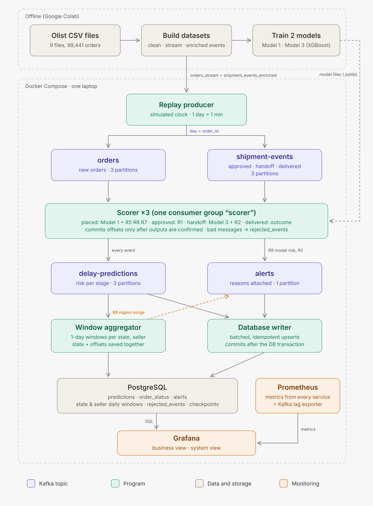

# Olist delivery-delay prediction — real-time streaming pipeline

*Course project — AI372IA Stream Processing and Analytics, Dept. of AIML, RV College of Engineering, Bengaluru.*

Kafka-centred pipeline that replays real Olist orders (May–Oct 2018) and predicts late delivery at each stage:
**Model 1** when the order is placed, a rule tag at approval, **Model 3** at carrier handoff, and the real outcome at delivery.



## Quick start

```powershell
git clone https://github.com/1921-affan/olist-delay-streaming.git
cd olist-delay-streaming
Copy-Item .env.example .env      # then open .env and set your own passwords
powershell -ExecutionPolicy Bypass -File .\demo_reset.ps1
```

Then open Grafana at http://localhost:3000 (login from your `.env`) and Kafka UI at http://localhost:8080. Details below.

| Circular requirement | Where |
|---|---|
| Kafka central, producer + consumer | `producer/`, `scorer/`, `db_writer/`, `window_aggregator/` |
| ≥ 2 topics | `orders`, `shipment-events`, `delay-predictions`, `alerts` |
| Partitioning + consumer groups | 3 partitions keyed by `order_id`; `scorer` group with 3 copies; `db-writer`, `window-aggregator` groups |
| Window operation | 1-day tumbling event-time windows per state and seller (`window_aggregator/windows.py`) |
| Aggregation | late rate, average risk, alert counts, top sellers, 7-day rolling late rate |
| Fault tolerance | manual offset commits after work is saved, idempotent upserts, aggregator state + offsets in one DB transaction, bad messages to `rejected_events`, producer acks=all + idempotence + `--resume` |
| Storage | PostgreSQL 16 |
| Visualisation / alerts | Grafana dashboards, `alerts` topic |

---

## Dataset

### Source

**Brazilian E-Commerce Public Dataset by Olist** ([Kaggle](https://www.kaggle.com/datasets/olistbr/brazilian-e-commerce)): real, anonymised orders from the Olist marketplace in Brazil, placed between 2016 and 2018. It records each order's full life (purchase, payment approval, hand-over to the carrier, delivery) together with the delivery date that was **promised** to the customer, which is what makes delay prediction possible. It is split over 9 linked tables:

| Table | Rows | Used for |
|---|---:|---|
| `olist_orders_dataset` | 99,441 | order life-cycle timestamps; source of the late label |
| `olist_order_items_dataset` | 112,650 | price, freight, seller, seller's shipping deadline |
| `olist_products_dataset` | 32,951 | category, weight, dimensions |
| `olist_customers_dataset` | 99,441 | customer state and ZIP prefix |
| `olist_sellers_dataset` | 3,095 | seller state and ZIP prefix |
| `olist_geolocation_dataset` | 1,000,163 | ZIP-prefix coordinates (seller-to-customer distance) |
| `olist_order_payments_dataset` | 103,886 | payment type and instalments |
| `olist_order_reviews_dataset` | 99,224 | reviews (analysis only, never a model input) |
| `product_category_name_translation` | 71 | English category names |

The 9 tables were joined into one row per order (`olist_master_orders.csv`, 51 columns). The raw Kaggle files and the master file are **not** in this repository; download them from Kaggle to rebuild everything from scratch.

### Label

An order is **late** (`is_late = 1`) when it was delivered on a calendar day **after** its promised (estimated) delivery date; delivery on the promised day counts as on time. Orders that were never delivered get no label.

| | Orders |
|---|---:|
| All orders | 99,441 |
| Delivered (labelled) | 96,476 |
| Late | 6,535 (6.77%) |
| On time | 89,941 |
| Never delivered (no label) | 2,965 |

### Files in `data/`

| File | Rows | Period | Contents | Used by |
|---|---:|---|---|---|
| `orders_clean.csv` | 94,930 orders (6,517 late, 6.9%) | Jan 2017 – Aug 2018 | delivered single-seller orders with all features, timestamps, the `split` column and the label `is_late` | model training and evaluation (`notebooks/`, `training/`) |
| `orders_stream.csv` | 25,314 orders | placed 1 May – 29 Aug 2018 | checkout-time information only, **no label** | replay producer → topic `orders` |
| `shipment_events_enriched.csv` | 75,380 events | May – Oct 2018 | 25,314 `order_approved`, 25,138 `handed_to_carrier`, 24,928 `delivered`; each event carries only what is known at that moment; `delivered` carries `is_late_actual`; `bad_timestamp = 1` marks 154 events dated before their order | replay producer → topic `shipment-events` |
| `feature_registry.json` | – | – | which columns may be used at each stage and by each model (leakage guard) | data preparation, models |

`models/*_test_predictions.csv` hold each model's score for every test order (May – Aug 2018); `ops/verify_models.py` uses them to prove the streaming scorer gives the same probabilities as Colab.

### Columns and when they become known

Every column is tagged with the stage at which it becomes known, and a model may only use columns from its own stage or earlier. This prevents the model from "seeing the future".

| Stage | Columns |
|---|---|
| **Order placed** (23) | `promise_days`, `purchase_hour`, `purchase_weekday`, `price`, `freight`, `n_items`, `weight_g`, `volume_cm3`, `category`, `customer_state`, `seller_state`, `same_state`, `dist_km`, `pay_type`, `installments`, `seller_prior_orders`, `seller_late_rate_prior`, `seller_overrun_rate_prior`, `seller_handling_days_prior`, `route_recent_days`, `promise_buffer_route`, `promise_buffer_state`, `order_load_ratio` |
| **Payment approved** (1) | `approval_lag_h` |
| **Handed to carrier** (3) | `handling_days`, `seller_overrun_days`, `post_approval_days` |
| **Delivered** | `is_late` / `is_late_actual` (the label, never an input) |

Engineered columns:

| Column | Meaning |
|---|---|
| `dist_km` | great-circle distance between the seller's and customer's ZIP-prefix centroids |
| `promise_days` | days from purchase to the promised delivery date |
| `route_recent_days` | recent typical delivery time on the same seller-state → customer-state route |
| `promise_buffer_route`, `promise_buffer_state` | promised days minus the recent typical delivery time (small buffer = risky promise) |
| `seller_prior_orders`, `seller_late_rate_prior`, `seller_overrun_rate_prior`, `seller_handling_days_prior` | the seller's past record, computed only from orders delivered **before** this order was placed |
| `order_load_ratio` | current order volume relative to recent volume |
| `approval_lag_h` | hours from purchase to payment approval |
| `handling_days`, `post_approval_days` | days from purchase / approval to the carrier hand-over |
| `seller_overrun_days` | hand-over time minus the seller's shipping limit (positive = deadline missed) |

### Features used by the models

| Model | Scored when | Features |
|---|---|---|
| **Model 1** (XGBoost, 12) | order placed | `promise_days`, `purchase_hour`, `price`, `freight`, `category`, `customer_state`, `dist_km`, `seller_overrun_rate_prior`, `seller_handling_days_prior`, `route_recent_days`, `promise_buffer_route`, `promise_buffer_state` |
| **Model 3** (XGBoost, 10) | carrier handoff | `promise_days`, `weight_g`, `customer_state`, `dist_km`, `route_recent_days`, `promise_buffer_route`, `promise_buffer_state`, `handling_days`, `seller_overrun_days`, `post_approval_days` |

### Train / calibration / test split (by time, never random)

| Part | Purchase months | Orders | Late | Late rate |
|---|---|---:|---:|---:|
| Train | Jan 2017 – Mar 2018 | 63,332 | 5,097 | 8.0% |
| Calibration (probabilities + alert threshold) | Apr 2018 | 6,670 | 306 | 4.6% |
| Test (never used for any choice) | May – Aug 2018 | 24,928 | 1,114 | 4.5% |

The test months are also the months replayed through Kafka.

### What the data shows (EDA)

* **Distance:** the late rate rises from 4.5% on routes under 100 km to 11.6% beyond 1,500 km; cross-state orders are late 8.0% of the time vs 4.5% within a state.
* **Payment:** boleto (bank slip) payments take a median of about 29 h to be approved vs about 16 min for credit cards.
* **The signal grows with the stage:** the best purchase-time column alone reaches a ROC-AUC of only 0.58, while hand-over columns reach 0.66. Late orders spend longer with the seller (median 3.5 vs 2.2 days) and much longer in transit (26 vs 7 days). This is why the order is scored again at hand-over.
* **Drift:** the monthly late rate moves from 2.8% (Jul 2017) to 12.4% (Nov 2017, Black Friday) and 19.0% (Mar 2018), so the split is chronological and rule R8 watches for regional surges live.

Full analysis: `notebooks/olist_delay_eda_model1_top15_colab.ipynb` and `docs/SPA_Dataset_Description_and_EDA_Team10.pdf`. Data-quality notes are in section 13 below.

### Licence

The Olist dataset is published under **CC BY-NC-SA 4.0** (attribution, non-commercial, share-alike). The data files in this repository are derived from it and are shared under the same terms.

---

## 1. Requirements

* **Docker Desktop** running, with **at least 6 GB memory** (Settings → Resources → Memory).
* Free ports on your laptop: **9094** (Kafka), **8080** (Kafka UI), **5433** (PostgreSQL), **9090** (Prometheus), **3000** (Grafana).
  Kafka uses 9094 and PostgreSQL 5433 so they don't clash with a Kafka or PostgreSQL already installed on your laptop. You do not need your local Kafka for this project.
* `data/` must contain `orders_stream.csv` and `shipment_events_enriched.csv`; `models/` must contain both `.joblib` files and both `*_test_predictions.csv` files (already included in this repository).

All commands below are run in a terminal **inside this folder** (VS Code terminal is fine; PowerShell or bash).

## 2. Start everything

```bash
cp .env.example .env                 # PowerShell: Copy-Item .env.example .env — then set your own passwords
docker compose build                 # first time: ~3–5 min (installs scikit-learn 1.6.1, xgboost 3.4.1, …)
docker compose up -d                 # starts Kafka, creates topics, PostgreSQL, 3 scorers, db-writer, aggregator, monitoring
docker compose ps                    # all "running" / "healthy"; kafka-init shows "exited (0)"
docker compose logs kafka-init       # should list the 4 topics with partitions 3/3/3/1
docker compose logs scorer-1         # "Model 1 (12 cols, thr 0.7493) | Model 3 (10 cols, thr 0.7364) loaded" + ASSIGNED partitions
```

## 3. Check the models inside Docker (once)

```bash
docker compose run --rm --entrypoint python scorer-1 ops/verify_models.py
```
Expected: `Model 1: … max |difference| … -> OK` and `Model 3: … -> OK`. This proves the streaming code gives the same scores as Colab.

## 4. Smoke test — 2 simulated days in ~2 seconds per day

```bash
docker compose run --rm --name producer producer --start 2018-06-01 --end 2018-06-03 --speed 86400
docker compose exec postgres psql -U olist -d olist -c "SELECT stage, COUNT(*) FROM predictions GROUP BY stage ORDER BY 1;"
```
`--speed 86400` = 1 simulated day per real second. You should see counts for placed / approved / handoff / delivered.

## 5. Open the UIs

| UI | URL | Login |
|---|---|---|
| Grafana — business dashboard (home) | http://localhost:3000 | user and password from your `.env` |
| Grafana — system dashboard | Dashboards → *Olist delay streaming* → system view | |
| Kafka UI (topics, partitions, consumer groups) | http://localhost:8080 | |
| Prometheus (targets, raw metrics) | http://localhost:9090/targets | |

The business dashboard uses **simulated 2018 time** (default range 15 May – 31 Oct 2018). The system dashboard uses real time (last 15 minutes).

## 6. The demo replay (1 simulated day = 1 real minute)

```bash
docker compose run --rm --name producer producer                      # uses .env: start 2018-05-20, speed 1440
docker compose run --rm --name producer producer --start 2018-07-15   # start later
docker compose run --rm --name producer producer --speed 2880         # 1 day = 30 s
```
Stop with **Ctrl+C**; continue later with `--resume` — it reuses the original run's start, end and speed automatically, so just type `--resume`. Each order's approval, handoff and delivery are sent later, after the same gap they had in 2018, interleaved with every other order's events.

### Presentation day (fresh system every time)

The CSV files are only read, never used up — replay them as often as you like; results are identical every time.

```powershell
powershell -ExecutionPolicy Bypass -File .\demo_reset.ps1          # wipe, start, fill 20 May - 20 Jul (~2-3 min)
docker compose run --rm --name producer producer --start 2018-07-20   # LIVE in front of the examiners, 1 day / min
```
`demo_reset.ps1` runs `docker compose down -v` (deletes all data), `build`, `up -d`, waits for the scorers, then fills the history at 1 simulated day per second.

## 7. Fault-tolerance demos

See **`ops/fault_demo.md`** — scorer copy killed (rebalance), DB writer down (lag + catch-up, no duplicates), window aggregator crash (identical totals), bad messages, producer resume, broker restart.

## 8. Add a Grafana alert rule (2 minutes, by hand)

Grafana → Alerting → Alert rules → **New alert rule**:
1. Query (Prometheus): `sum(kafka_consumergroup_lag{consumergroup="scorer"})`
2. Threshold: **IS ABOVE 500**; evaluate every 10s, pending period 30s.
3. Folder *Olist*, group *pipeline*, name *Scorer lag high* → Save.
Second rule (PostgreSQL, table format): `SELECT COUNT(*) FROM alerts WHERE alert_type='region_surge' AND processed_at > now() - interval '1 minute'` IS ABOVE 0 → *Region surge detected*.

## 9. Useful SQL

```bash
docker compose exec postgres psql -U olist -d olist
```
```sql
SELECT stage, COUNT(*) FROM predictions GROUP BY 1;                               -- one row per order per stage
SELECT * FROM v_live_risk ORDER BY late_prob_pct DESC LIMIT 10;                   -- riskiest open orders
SELECT * FROM alerts ORDER BY event_time DESC LIMIT 10;                           -- alert feed
SELECT * FROM state_daily_windows ORDER BY window_start DESC, late_rate DESC LIMIT 20;
SELECT reason, COUNT(*) FROM rejected_events GROUP BY 1;                          -- bad / skipped messages
SELECT * FROM replay_runs ORDER BY started_at DESC;
```

## 10. Reset

```bash
docker compose down          # stop, keep data
docker compose down -v       # stop and DELETE all data (Kafka topics, database, checkpoints) — fresh start
```

## 11. Settings (`.env`)

| Setting | Default | Meaning |
|---|---|---|
| `REPLAY_SPEED` | 1440 | simulated seconds per real second (1440 = 1 day/min, 86400 = 1 day/s) |
| `REPLAY_START` / `REPLAY_END` | 2018-05-20 / 2018-10-31 | replay window (2018 event time) |
| `R1_APPROVAL_HOURS` … `R7_*` | 24, 10, 1000, 0.15, 20 | rule thresholds |
| `R8_LATE_RATE`, `R8_MIN_DELIVERIES`, `R8_ROLLING_DAYS` | 0.15, 50, 7 | region surge rule |
| `WINDOW_GRACE_HOURS` | 6 | how long (simulated) a day window waits for late events before closing |
| `WINDOW_MAX_LATENESS_DAYS` | 7 | events older than this behind the watermark are ignored (allowed lateness) |
| `AGG_CHECKPOINT_SECONDS` | 5 | aggregator save interval |

## 12. Troubleshooting

| Problem | Fix |
|---|---|
| `port is already allocated` | another program uses that port — stop it or change the left-hand port in `docker-compose.yml` |
| scorer logs `version mismatch` | the image must have scikit-learn 1.6.1 and xgboost 3.4.1 (`requirements.txt`); rebuild with `docker compose build --no-cache` |
| Prometheus target `producer` is DOWN | normal when no replay is running |
| Grafana business panels empty | run a replay; check the time range is in 2018 |
| Kafka unhealthy after a crash | `docker compose down -v` and `up -d` again (deletes data) |
| Need to re-run from scratch | `docker compose down -v` then `up -d` |

## 13. Known data notes

* 154 handoff events are dated before their order was placed (Olist data error) → skipped, stored in `rejected_events` with reason `event_before_purchase`.
* 675 orders (2.7%) were approved *after* the carrier handoff in the raw data. The scorer handles each event on its own and `order_status` keeps the furthest stage, so this is harmless.
* The first days after 1 May look quiet because orders placed in April (whose handoffs/deliveries happen in early May) are not in the replay — hence the default start of 20 May.

## 14. Project layout

```
common/            config, Kafka factories, message schemas, DB helper
producer/          replay.py (timeline logic), producer.py
scorer/            models.py (bundles), rules.py (R1–R7), logic.py (stage logic), scorer.py
db_writer/         sql.py (idempotent upserts), db_writer.py
window_aggregator/ windows.py (tumbling windows, R8, checkpoint), aggregator.py
infra/             kafka/create_topics.py, postgres/init.sql, prometheus/, grafana/
ops/               verify_models.py, inject_bad_message.py, fault_demo.md
tests/             offline tests (pytest), no Kafka needed
data/              replay files, orders_clean.csv (training table), feature_registry.json
models/            production Model 1 / Model 3 bundles + test predictions
notebooks/         Colab notebooks: EDA + Model 1 selection, Model 3 feature selection, Model 3 training
data_prep/         build_datasets.py, check_datasets.py, enrich_shipment_events.py
training/          retrain_xgb12_corrected_split.py, model inference examples
results/           all metrics and comparison tables behind the report
docs/              report, synopsis, EDA, literature survey, research paper, architecture diagram
```

To rebuild the datasets from scratch, create `olist_master_orders.csv` from the 9 Kaggle Olist files (not included) and run `python data_prep/build_datasets.py --master olist_master_orders.csv --out data`.

Offline tests (optional, needs Python with pandas, scikit-learn, pytest): `python -m pytest -q tests`
